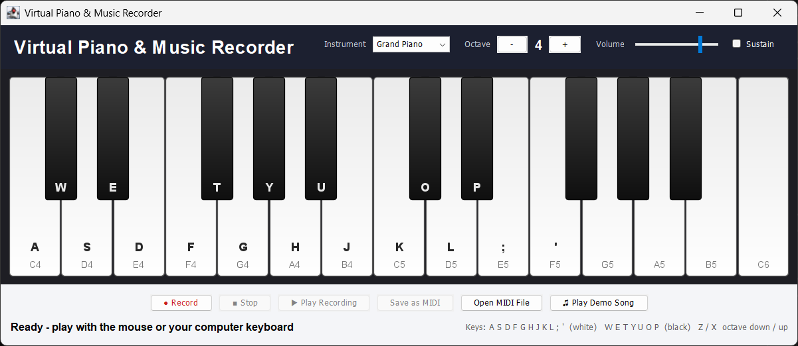

# Virtual Piano & Music Recorder

A desktop piano application built with **Java Swing** and the **Java Sound MIDI API**.
Play music with the mouse or your computer keyboard, switch between 16 instruments,
record what you play, play it back and save it as a standard **MIDI (`.mid`) file**.



## Features
- **Playable two-octave piano.** Click keys with the mouse (drag to glide across keys) or use the computer keyboard.
- **16 instruments**, including Grand Piano, Electric Piano, Organ, Guitar, Violin, Cello, Trumpet, Saxophone, Flute, Synth and Steel Drums.
- **Octave shift** from 1 to 6, using the **- / +** buttons or the **Z / X** keys.
- **Volume** slider and **Sustain** pedal.
- **Recorder.** Record your performance with a live timer and note counter.
- **Playback.** The piano keys light up as the recording plays.
- **Save as MIDI.** Exports a `.mid` file that opens in any music player or software such as GarageBand, FL Studio or MuseScore.
- **Open MIDI File.** Plays any `.mid` file and shows its notes on the keyboard.
- **Demo song.** Plays *Ode to Joy* (Beethoven) in the selected instrument.

**Only Java is required.** The project uses Java's built-in synthesizer, so it needs no external libraries, sound files or database.

## Keyboard Controls
```
 Black keys:   W  E     T  Y  U     O  P
 White keys:  A  S  D  F  G  H  J  K  L  ;  '
 Notes:       C  D  E  F  G  A  B  C  D  E  F
```
| Key | Action |
|-----|--------|
| `A S D F G H J K L ; '` | White keys (C to F, across two octaves) |
| `W E T Y U O P` | Black keys (sharps) |
| `Z` / `X` | Octave down / up |

## Architecture (MVC)
```
        +------------------------------+
        |            VIEW              |   piano.view
        |  PianoView     (JFrame)      |   window, buttons, sliders
        |  KeyboardPanel (JPanel)      |   draws keys, reports mouse clicks
        +---------------+--------------+
                        | events (mouse, keys, buttons)
                        v
        +------------------------------+
        |         CONTROLLER           |   piano.controller
        |  PianoController             |   maps keys -> notes, handles buttons
        +---------------+--------------+
                        | method calls
                        v
        +------------------------------+
        |            MODEL             |   piano.model
        |  PianoModel   - Synthesizer, MidiChannel, Sequencer
        |  Recorder     - timing of notes, builds MIDI Sequence
        |  DemoSong     - built-in tune
        |  PlaybackListener - tells the view which keys to light up
        +------------------------------+
```

## Project Structure
```
Virtual-Piano-Music-Recorder
├── src/piano
│   ├── Main.java                         – entry point
│   ├── model
│   │   ├── PianoModel.java               – sound engine (synthesizer, instruments, playback)
│   │   ├── Recorder.java                 – records notes and saves MIDI files
│   │   ├── DemoSong.java                 – "Ode to Joy" demo melody
│   │   └── PlaybackListener.java         – callback interface for key highlighting
│   ├── view
│   │   ├── PianoView.java                – main window (JFrame)
│   │   └── KeyboardPanel.java            – custom-drawn piano keyboard (JPanel)
│   └── controller
│       └── PianoController.java          – connects view and model
├── screenshots/piano.png
├── run.bat                               – compile and run (Windows)
├── run.sh                                – compile and run (Linux / macOS)
└── README.md
```

## How to Run
**Requirement:** Java JDK 8 or later (`java -version`).

**Windows:** double-click `run.bat`, or in a terminal:
```bash
javac -d out -sourcepath src src/piano/Main.java
java -cp out piano.Main
```
**Linux / macOS:**
```bash
sh run.sh
```
**VS Code / IntelliJ / Eclipse:** open the folder, mark `src` as the source root and run `piano.Main`.

## How to Use
1. Press keys or click the piano to play. Pick an instrument from the drop-down.
2. Click **Record**, play a tune, then click **Stop**.
3. Click **Play Recording** to hear it back. The keys light up as it plays.
4. Click **Save as MIDI** to export it as a `.mid` file.
5. Use **Open MIDI File** to play any MIDI song, or **Play Demo Song** for a quick demo.

## Java Concepts Used
| Concept | Where |
|---------|-------|
| Swing GUI: `JFrame`, `JPanel`, `JButton`, `JComboBox`, `JSlider`, `JCheckBox`, `JFileChooser`, `JOptionPane` | `PianoView`, `PianoController` |
| Custom painting with `Graphics2D` (gradients, anti-aliasing) | `KeyboardPanel.paintComponent()` |
| Event handling: `ActionListener`, `ChangeListener`, `MouseAdapter`, `KeyEventDispatcher`, `WindowAdapter` | `PianoController`, `KeyboardPanel` |
| **MVC architecture** with packages | `model`, `view`, `controller` |
| Java Sound MIDI API: `Synthesizer`, `MidiChannel`, `Sequencer`, `Sequence`, `Track`, `ShortMessage`, `MetaMessage`, `Receiver` | `PianoModel`, `Recorder`, `DemoSong` |
| Interfaces and callbacks | `PlaybackListener`, `KeyboardPanel.NoteListener` |
| Inner and anonymous classes, lambda expressions | `TapReceiver`, listeners |
| Collections: `HashMap`, `ArrayList` | key mapping, recorded events |
| Multithreading: Swing EDT, `SwingUtilities.invokeLater`, `javax.swing.Timer` | playback highlighting, recording timer |
| File handling: writing and reading `.mid` files | `Recorder.save()`, `PianoModel.playFile()` |
| Exception handling | MIDI errors, file errors |

## How It Works
- **Playing a note:** the controller converts a key (e.g. `A`) into a MIDI note number (`60` = middle C)
  and calls `MidiChannel.noteOn(60, velocity)` on Java's built-in synthesizer.
- **Instruments:** `MidiChannel.programChange(n)` switches to General MIDI instrument number `n`
  (0 = piano, 40 = violin, 73 = flute, …).
- **Recording:** every note-on and note-off is stored with its time in milliseconds.
  With 500 ticks per beat at 120 BPM, **1 tick = 1 ms**, so the times convert directly into a MIDI `Track`.
- **Playback:** a `Sequencer` plays the `Sequence`. A custom `Receiver` forwards the notes to the synthesizer
  and notifies the view so the keys light up.
- **Saving:** `MidiSystem.write(sequence, 0, file)` writes a standard MIDI file.
